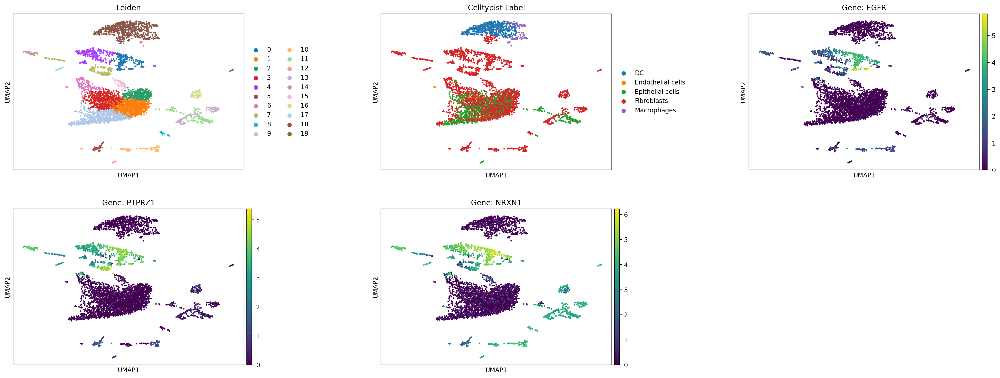
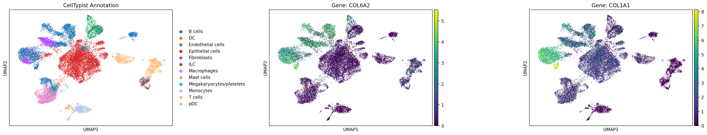
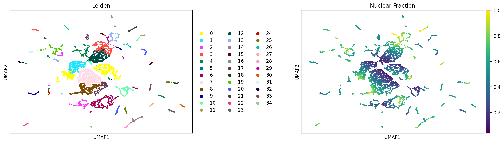
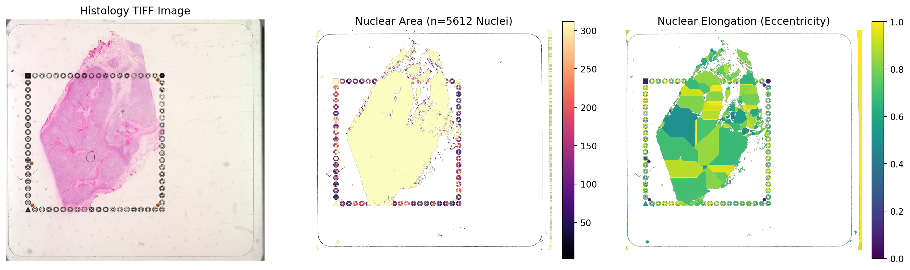

# Universal Human Tumor Microenvironment & Multi-Modal Atlas

An end-to-end, CPU-optimized computational biology CLI pipeline for analyzing **10x Genomics human clinical datasets** and public single-cell, spatial, multi-modal, and histology atlases.

The pipeline features a **universal auto-detecting loader** (`.h5`, `.h5ad`, `.h5mu`, `.parquet`, `.tif`/`.ome.tif`, `.mtx`/`.mtx.gz`, `.csv`/`.tsv`, and 10x Visium spatial directories) and automatically organizes every run into dedicated `figures/<dataset_name>/` and `results/<dataset_name>/` subdirectories.

---

## Key Capabilities
1. **Spatial & Single-Cell Tumor Microenvironment**: Processes **10x Visium Spatial Transcriptomics**, **10x Multiome**, and **10x FFPE Flex** tumor samples (`Scanpy` + `Squidpy`), delineates tumor vs. stromal niches, extracts marker genes, and infers active human ligand-receptor cell signaling (`LIANA`).
2. **Multi-Modal CITE-seq / TotalSeq-C (`MuData`)**: Automatically splits multi-modal 10x `.h5` matrices (`Gene Expression` + `Antibody Capture`) into a unified `MuData` container, annotates human immune cell types (`CellTypist`), and benchmarks multi-modal classification (`scikit-learn`).
3. **Multi-Donor Cohort Integration (`ComBat`)**: Concatenates independent human donors, removes technical batch effects, aligns shared cell populations, and evaluates cross-donor machine learning generalization.
4. **Visium HD Parquet & Histology TIFF Analysis**: Parses 10x Visium HD subcellular square mappings (`barcode_mappings.parquet`), Xenium transcripts (`transcripts.parquet`), cell-group annotation CSVs, and pyramid `.tif`/`.ome.tif` histology images (`Watershed` nuclei segmentation and morphology metrics).

---

## Visualizations

### 1. 10x Human Brain Multiome — Clusters, Cell Types & Marker Genes (`EGFR`, `PTPRZ1`, `NRXN1`)


### 2. Multi-Donor Cohort Integration — Before vs. After ComBat & CellTypist Annotation


### 3. 10x Visium HD Breast Cancer (`850k Cells`) & Human Tonsil Histology Morphology

| Visium HD Subcellular Bin Clusters | Human Tonsil OME-TIFF Nuclei Segmentation |
| :---: | :---: |
|  |  |


## Repository Structure

```text
human-tumor-microenvironment-atlas/
├── main.py                     # Universal CLI entry point (--input / --donor2 / --genes)
├── requirements.txt            # CPU-compatible Python dependencies
├── .gitignore                  # Excludes large raw datasets while keeping figures & CSVs
├── figures/                    # Auto-organized multi-panel plots per dataset run
├── results/                    # Auto-organized marker, LIANA & morphology CSVs per run
└── src/
    ├── loaders.py              # Universal auto-detecting loader across all omics & image formats
    ├── qc_and_integration.py   # Human MT- QC, normalization, Leiden, & ComBat batch correction
    ├── annotation.py           # CellTypist human annotation & cluster biomarker extraction
    ├── signaling.py            # LIANA human ligand-receptor intercellular communication
    └── ml_generalization.py    # Spatial niche & cross-donor classifier evaluation
```

---

## Installation

```bash
git clone https://github.com/Mark6278/human-tumor-microenvironment-atlas.git
cd human-tumor-microenvironment-atlas
pip install -r requirements.txt
```

---

## CLI Usage Examples

### Wrapper Script (`./run_pipeline.sh`)
`run_pipeline.sh` supports both **full batch execution** (when called with no arguments) and **direct CLI argument forwarding** (`--input`, `--donor2`, `--genes`, `--resolution`):

```bash
chmod +x run_pipeline.sh

# 1. Full Batch Mode (runs built-in 10x demos + all supported datasets in data/)
./run_pipeline.sh

# 2. Forward custom CLI flags directly through run_pipeline.sh
./run_pipeline.sh --input data/17k_Ovarian_Cancer_scFFPE_count_filtered_feature_bc_matrix.h5 --resolution 0.4
./run_pipeline.sh --input data/10k_Human_Brain_MO_gemx_raw_feature_bc_matrix/raw_feature_bc_matrix/ --genes EGFR MAP2 NRXN1
./run_pipeline.sh --input data/donor1.h5 --donor2 data/donor2.h5
```

### Direct Python CLI (`python main.py`)
```bash
# 1. Built-in 10x Human Breast Cancer Visium Spatial Demo (no local files needed)
python main.py

# 2. Single-Cell Tumor or Brain Dataset (.h5, .h5ad, or 10x .mtx folder)
python main.py --input data/17k_Ovarian_Cancer_scFFPE_count_filtered_feature_bc_matrix.h5

# 3. Multi-Modal CITE-seq / TotalSeq-C (auto-detected as MuData RNA + Surface Protein)
python main.py --input data/16k_Human_PBMCs_TotalseqC_4plex_PBMC_TotalSeqC_C-A01_sample_filtered_feature_bc_matrix.h5

# 4. Visium HD Parquet Subcellular Bins or Histology OME-TIFF Nuclei Morphology
python main.py --input data/Visium_HD_11mm_Human_Breast_Cancer_barcode_mappings.parquet
python main.py --input data/Visium_HD_3prime_Human_Tonsil_image.tif
```
